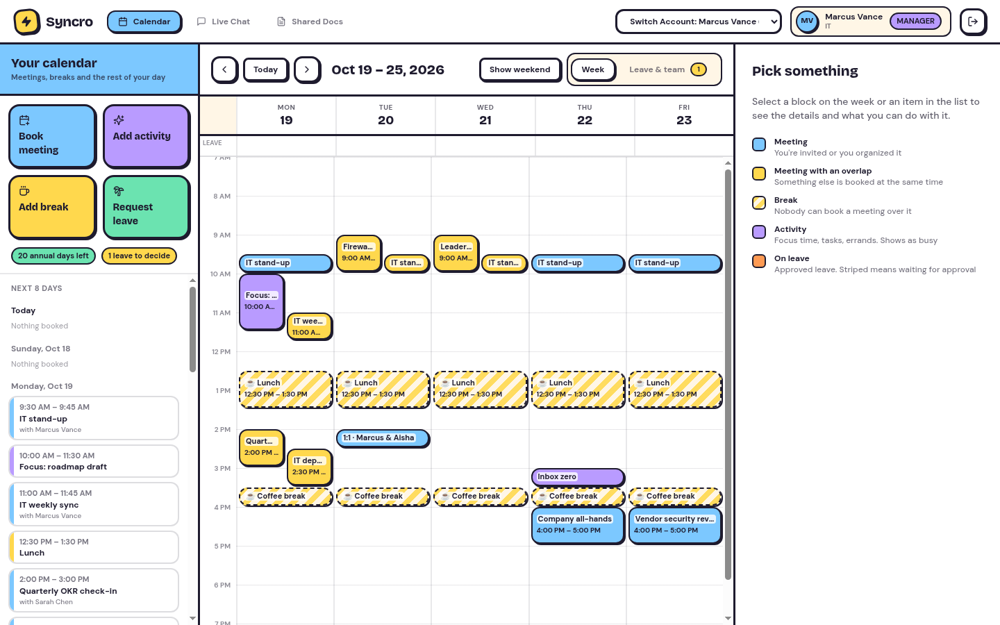
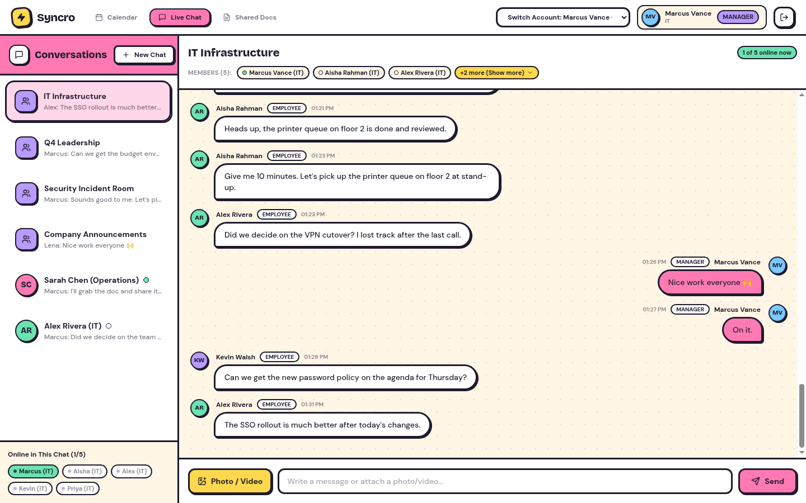
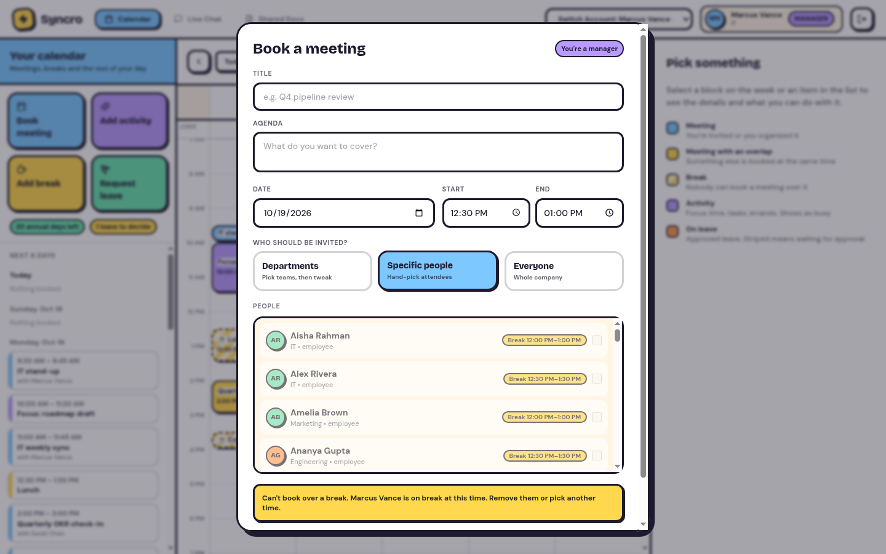
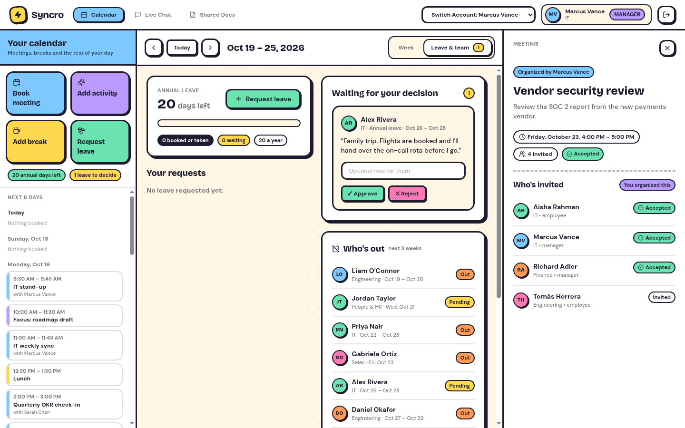
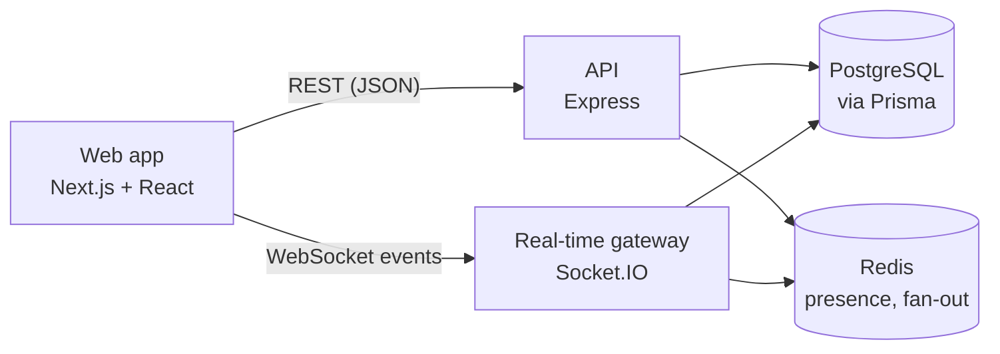

# Syncro

**One workspace for the whole company:** team chat, a shared calendar that knows about breaks and leave, and documents that several people can edit at the same time.



Syncro is a full-stack demo of a real internal tool. It ships with a realistic 44-person company (8 departments, two weeks of meetings, breaks, leave requests, hundreds of chat messages, and shared documents), so you can click through it the way a teammate would.

---

## Features

### Chat
- Direct messages and group channels, with unread counts.
- Live typing indicators and presence (who is online in this conversation).
- Photo and video attachments, up to 10 MB.
- A GIF & photo picker in the composer sends a random GIF or photo with one click. Shuffle gives you a new set.
- Only members can read or send in a conversation. The server checks this on every request and every socket message.



### Calendar
The calendar is a week-by-time grid with your meetings, breaks, activities and leave in one place.

- **Meetings**: book for specific people, for whole departments, or for everyone (managers and admins). Attendees accept, or send an excuse request to the organizer, who can allow or deny it with a reply.
- **Breaks**: lunch, coffee or any other break. Nobody can be booked over a break, and the server says exactly who is on break.
- **Activities**: focus time, tasks, training, errands. They show as busy to colleagues. Titles stay private, but overlaps are flagged like meeting clashes.
- **Leave**: request annual, sick or personal leave in advance. Managers approve it for their own department, admins approve managers. The day is held as soon as it's requested.
- **Availability**: check whether people are free, busy, on break or on leave. You see the time blocks and their type, never the titles.

### Shared documents
- Several people edit the same document at once, with changes merged automatically (Yjs CRDT).
- Owners share with **editor** or **viewer** access. Viewers are read-only, and the server rejects their edits.
- Changes are saved as you type.

---

### Chat simulator

Want the company to feel alive? Run the simulator while the server is up:

```bash
npm run simulate
```

It signs in as a handful of seeded teammates and has them chat for real over the same WebSocket path the web app uses. They start typing, send messages, post random GIFs and photos, and sometimes type something and delete it. You'll see the typing bubbles and unread badges update live in the browser.

| Variable | Default | What it does |
| --- | --- | --- |
| `SIM_USERS` | `10` | How many teammates to simulate |
| `SIM_MIN_GAP_MS` | `6000` | Shortest pause between one person's actions |
| `SIM_MAX_GAP_MS` | `20000` | Longest pause between one person's actions |

Example: `SIM_USERS=20 SIM_MIN_GAP_MS=2000 SIM_MAX_GAP_MS=8000 npm run simulate`

Press Ctrl+C to stop. Photos come from picsum.photos and GIFs from GIPHY and cataas.com, so the images load only when the machine is online.

---

## Calendar rules (enforced on the server)

The UI shows these rules, but the server is the one that enforces them.

| Rule | What happens |
| --- | --- |
| Nobody gets a meeting over their break | The booking is rejected with HTTP 409 and lists who is on break and when |
| People on leave can't be picked | Picking someone on leave is rejected. Department and company-wide invites skip them and report who was skipped |
| Leave has to be requested in advance | It must start at least one working day ahead. Weekends don't count, and one request covers up to 30 days |
| Annual leave allowance | 20 working days a year. A request that goes over the allowance is rejected |
| Leave approval | The requester's department manager, or an admin, decides. Nobody approves their own request |
| Breaks can't overlap a meeting | Adding a break over a meeting you're invited to is rejected |
| Activities are soft busy time | They don't block bookings. A clash gets an overlap flag, and the excuse flow applies |
| No bookings in the past | Meetings and entries that have already started are rejected |
| Privacy | Free/busy only ever returns time blocks and their type |

The rules are unit-tested in [`server/tests/calendar-rules.test.ts`](server/tests/calendar-rules.test.ts). They are judged on company days, using the timezone set in `COMPANY_TIMEZONE`.

---

## Quick start

**Requirements:** Node.js 20 or newer, npm 10 or newer, and Docker (for PostgreSQL and Redis).

```bash
git clone git@github.com:Mayank-Bhatasana/syncro.git
cd syncro

docker compose up -d                  # PostgreSQL on :5433, Redis on :6380
npm install

cp server/.env.example server/.env    # then edit values if you need to
npm run db:migrate                    # create the tables
npm run db:seed                       # load the demo company

npm run dev:server                    # API on http://localhost:4000
npm run dev:client                    # web app on http://localhost:3000
npm run simulate                      # optional: teammates start chatting on their own
```

Open http://localhost:3000 and sign in with any account below.

Run the test suite with:

```bash
npm test
```

> **Heads up:** `npm run db:seed` deletes all existing data before loading the demo company.

---

## Demo company

Every account uses the password **`password123`**. The seed is deterministic, but its dates are relative to the day you run it, so the "next Monday" storyline always lands on the next working day.

| Person | Role | Department | Email |
| --- | --- | --- | --- |
| Sarah Chen, Chief Operating Officer | Admin | Operations | `sarah.admin@syncro.io` |
| Marcus Vance, IT Manager | Manager | IT | `marcus.manager@syncro.io` |
| Elena Rostova, HR Lead | Manager | People & HR | `elena.hr@syncro.io` |
| Daniel Okafor, Engineering Manager | Manager | Engineering | `daniel.okafor@syncro.io` |
| Nadia Kowalski, Head of Product | Manager | Product | `nadia.kowalski@syncro.io` |
| Richard Adler, Finance Director | Manager | Finance | `richard.adler@syncro.io` |
| Olivia Grant, Sales Director | Manager | Sales | `olivia.grant@syncro.io` |
| Rachel Greene, Marketing Manager | Manager | Marketing | `rachel.greene@syncro.io` |
| Tom Becker, Office & Facilities Manager | Manager | Operations | `tom.becker@syncro.io` |
| Alex Rivera, Systems Engineer | Employee | IT | `alex.it@syncro.io` |
| Priya Nair, Network Engineer | Employee | IT | `priya.it@syncro.io` |
| Jordan Taylor, HR Generalist | Employee | People & HR | `jordan.hr@syncro.io` |
| Liam O'Connor, Senior Software Engineer | Employee | Engineering | `liam.eng@syncro.io` |

Plus 31 more people across the company, with chat history, calendars and documents to explore.

### Things to try

1. **Sign in as Alex.** On the next working day, Alex is invited to two overlapping meetings. He sends an excuse request.
2. **Sign in as Marcus.** Open the IT security sync and allow or deny Alex's request.
3. **Sign in as Priya.** She has a dentist appointment in the middle of a firewall review. Marcus has already allowed the excuse.
4. **Sign in as Alex, then request leave** for a date at least a working day away. Watch the day get held on the calendar.
5. **Sign in as Marcus, open Leave & team.** Approve or reject Alex's pending request.
6. **Try booking over a lunch break.** Set the time to 12:30 and invite someone. The booking is blocked and the break is named.





---

## How it's built



### Repository layout

```text
syncro/
├── docker-compose.yml        PostgreSQL and Redis for local development
├── shared/                   Zod schemas, types and the GIF/photo catalog used by server and client
├── server/
│   ├── prisma/
│   │   ├── schema.prisma     Data model
│   │   └── seed.ts           Demo company generator
│   ├── scripts/
│   │   └── simulate-chat.ts   Chat simulator (npm run simulate)
│   ├── src/
│   │   ├── modules/
│   │   │   ├── auth/         Login, current user, users, departments
│   │   │   ├── chat/         Conversations and message history
│   │   │   ├── calendar/     Meetings, availability, breaks and activities
│   │   │   ├── leave/        Leave requests, approvals, balances, team view
│   │   │   ├── docs/         Shared documents and sharing
│   │   │   ├── calendar-rules.ts   Pure rules (leave dates, entry windows, repeats)
│   │   │   ├── permissions.ts      Roles and access checks
│   │   │   └── time.ts       Company-timezone day handling
│   │   └── socket/           Real-time chat, presence and document sync
│   └── tests/                Unit tests for rules and permissions
└── client/
    └── src/
        ├── app/              Layout, login and the workspace shell
        ├── components/
        │   ├── calendar/     Week grid, details, booking, breaks, leave
        │   ├── ChatModule.tsx
        │   └── DocsModule.tsx
        ├── api/              Typed API client
        ├── socket/           Socket connection and live updates
        └── store/            Client state (presence, toasts)
```

### API overview

All endpoints are available under `/api`. Requests are authenticated with an HTTP-only cookie, or with a `Bearer` token.

| Area | Endpoints |
| --- | --- |
| Auth and people | `POST /auth/login`, `POST /auth/logout`, `GET /auth/me`, `GET /users`, `GET /departments` |
| Chat | `GET /conversations`, `POST /conversations`, `GET /conversations/:id/messages` |
| Meetings | `GET /calendar`, `POST /events`, `PATCH /events/:id/accept`, `PATCH /events/:id/excuse`, `PATCH /events/:id/attendees/:userId/decision` |
| Availability | `GET /availability?userIds&from&to` returns busy blocks only (meeting, activity, break, leave) |
| Breaks and activities | `GET /entries`, `POST /entries` (optionally repeated on weekdays), `DELETE /entries/:id` |
| Leave | `GET /leave`, `POST /leave`, `GET /leave/approvals`, `GET /leave/team`, `PATCH /leave/:id/decision`, `PATCH /leave/:id/cancel` |
| Documents | `GET /documents`, `POST /documents`, `GET /documents/:id`, `PUT /documents/:id/share` |
| Health | `GET /health` |

Real-time events include `message:new`, `typing`, `presence:update`, `event:invited`, `event:excuse_requested`, `event:excuse_decided`, `leave:requested`, `leave:decided`, `doc:update` and `doc:collaborators`.

### Configuration

Set these in `server/.env` (see [`server/.env.example`](server/.env.example)):

| Variable | Default | What it does |
| --- | --- | --- |
| `PORT` | `4000` | API port |
| `DATABASE_URL` | local Docker PostgreSQL | Database connection |
| `REDIS_URL` | local Docker Redis | Presence and real-time fan-out |
| `JWT_SECRET` | a development value | Signs login tokens. Change it outside local development |
| `CLIENT_URL` | `http://localhost:3000` | Allowed origin for CORS and sockets |
| `COMPANY_TIMEZONE` | the machine's timezone | Which timezone "a day" means for leave, breaks and bookings |

The web app reads `NEXT_PUBLIC_API_URL` if you need to point it at another API (it defaults to `http://localhost:4000`).

---

## Tech stack

- **Web:** Next.js 14 (App Router), React 18, Tailwind CSS, TanStack Query, Zustand, Lucide icons
- **Real-time editing:** Yjs (conflict-free merging for shared documents)
- **API:** Node.js, Express, Socket.IO with the Redis adapter, Zod validation, JWT auth
- **Data:** PostgreSQL 16 through Prisma, Redis 7
- **Quality:** TypeScript across all packages, Vitest for unit tests

---

## Project notes

- The calendar's day rules are in `server/src/modules/time.ts`. Set `COMPANY_TIMEZONE` to your office's timezone.
- `SYNCRO_GUIDE.md` has a longer architecture walkthrough and interview-style Q&A.
- The data model is documented in `server/prisma/schema.prisma`.

Built by [Mayank Bhatasana](https://github.com/Mayank-Bhatasana).
